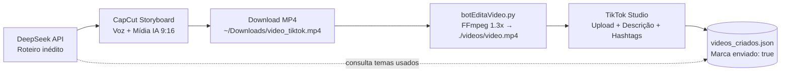

<div align="center">

# 🎬 Automação de Vídeos para TikTok

**Pipeline automatizado em Python para criação de roteiros com IA, geração de vídeos no CapCut, pós-processamento com FFmpeg e publicação no TikTok Studio.**


</div>

---

## ✨ Visão Geral

Este projeto automatiza o ciclo completo de produção e publicação de vídeos curtos verticais (`9:16`):

1. **Geração de roteiro e descrição via IA** usando a API do **DeepSeek** (com controle de histórico para evitar temas repetidos).
2. **Criação e exportação automática no CapCut AI Creator** (via interface gráfica com `PyAutoGUI` ou via navegador com `Playwright`).
3. **Edição e aceleração de vídeo/áudio** com **FFmpeg** (padrão `1.3x` com `setpts` e encadeamento automático de `atempo`).
4. **Publicação no TikTok Studio** com preenchimento automático de descrição e hashtags.

---

## 🔄 Fluxo da Automação



---

## 🧰 Tecnologias e Pré-requisitos

- **Python 3.10+**
- **[FFmpeg](https://ffmpeg.org/)** disponível no `PATH` (ou configurado via `FFMPEG_PATH`)
- **Google Chrome** (para os fluxos baseados em `PyAutoGUI`)
- **Firefox via Playwright** (para os fluxos baseados em `Playwright`)
- **Chave da API DeepSeek** ([platform.deepseek.com](https://platform.deepseek.com/))

---

## 📦 Instalação

1. **Clone o repositório e ative o ambiente virtual:**
   ```bash
   git clone https://github.com/bryanmeissner/publica_videos_tiktok.git
   cd publica_videos_tiktok
   python -m venv .venv
   ```

   ```bash
   # Linux / macOS
   source .venv/bin/activate

   # Windows (PowerShell)
   .venv\Scripts\Activate.ps1
   ```

2. **Instale as dependências Python e o navegador do Playwright:**
   ```bash
   pip install -r requirements.txt
   playwright install firefox
   ```

> **Nota:** o projeto utiliza `openai==0.28.1` para manter compatibilidade com `openai.ChatCompletion.create` e `openai.api_base`.

---

## ⚙️ Configuração Local

Todos os dados sensíveis ficam fora do controle de versão (bloqueados pelo `.gitignore`). Use os arquivos de exemplo incluídos no repositório:

### 1. Variáveis de ambiente (`.env`)
```bash
cp .env.example .env
```

| Variável | Obrigatória | Padrão | Descrição |
| :--- | :---: | :--- | :--- |
| `DEEPSEEK_API_KEY` | Sim | — | Chave da API DeepSeek para roteiros e descrições |
| `DEEPSEEK_API_BASE` | Não | `https://api.deepseek.com/v1` | Endpoint base compatível com OpenAI |
| `TIKTOK_COOKIES_FILE` | Playwright | `cookies_tiktok.json` | Caminho do JSON de cookies do TikTok |
| `CAPCUT_COOKIES_FILE` | Playwright | `cookies_capcut.json` | Caminho do JSON de cookies do CapCut |
| `DOWNLOADS_DIR` | Não | `~/Downloads` | Pasta onde os downloads brutos são salvos |
| `DOWNLOAD_VIDEO_PATH` | Não | `~/Downloads/video_tiktok.mp4` | Caminho do vídeo baixado antes da edição |
| `VIDEOS_DIR` | Não | `./videos` | Diretório dos vídeos já processados |
| `PROJECT_VIDEO_PATH` | Não | `./videos/video.mp4` | Caminho do vídeo acelerado pronto para envio |
| `DOWNLOADS_OUTPUT_DIR` | Não | `./downloads` | Pasta de downloads usada pelo `bot_playwright.py` |
| `VIDEOS_JSON_PATH` | Não | `./videos_criados.json` | Arquivo JSON com o histórico de vídeos |
| `CHROME_PATH` | Não | Detectado por SO | Caminho customizado do executável do Chrome |
| `FFMPEG_PATH` | Não | `ffmpeg` / `C:\ffmpeg\bin\ffmpeg.exe` | Caminho customizado do executável do FFmpeg |

### 2. Cookies de sessão (apenas para scripts Playwright)
Exporte os cookies do navegador no formato JSON tomando `cookies.example.json` como modelo:
- `cookies_capcut.json` → usado por `bot_playwright.py`
- `cookies_tiktok.json` → usado por `botTikTok.py`

> O carregador em `config.py` normaliza automaticamente valores de `sameSite` exportados por extensões (`no_restriction`, `unspecified`, `lax`, `strict`, `none`) e bloqueia valores placeholder.

### 3. Histórico de vídeos (`videos_criados.json`)
```bash
cp videos_criados.example.json videos_criados.json
```
Caso não exista, o sistema inicia com uma lista vazia (`[]`) automaticamente.

---

## 🚀 Como Usar

### Modo 1 — Pipeline completo via Interface Gráfica (`PyAutoGUI`)
Executa continuamente a cada ciclo (com intervalo de 1h30 entre vídeos): gera o roteiro no DeepSeek, cria e exporta o vídeo no CapCut, acelera com FFmpeg e publica no TikTok Studio:
```bash
python "bot pg.py"
```

### Modo 2 — Execução por etapas / Playwright
- **Gerar e baixar vídeo no CapCut (Playwright):**
  ```bash
  python bot_playwright.py
  ```
- **Acelerar vídeo com FFmpeg (`1.3x`):**
  ```bash
  python botEditaVideo.py
  ```
- **Publicar próximo vídeo pendente no TikTok (Playwright):**
  ```bash
  python botTikTok.py
  ```
- **Publicar próximo vídeo pendente no TikTok (PyAutoGUI):**
  ```bash
  python botTikTok_PG.py
  ```

---

## 📁 Estrutura do Projeto

```text
.
├── config.py                     # Carregamento de .env, cookies, caminhos e validação
├── bot pg.py                     # Orquestrador completo (DeepSeek + CapCut + FFmpeg + TikTok)
├── bot_playwright.py             # Automação do CapCut via Playwright
├── botEditaVideo.py              # Aceleração de vídeo/áudio com FFmpeg
├── botTikTok.py                  # Upload e publicação no TikTok Studio via Playwright
├── botTikTok_PG.py               # Upload e publicação no TikTok Studio via PyAutoGUI
├── img/                          # Templates de botões/telas usados pelo PyAutoGUI
├── .env.example                  # Modelo de variáveis de ambiente
├── cookies.example.json          # Modelo de estrutura de cookies
├── videos_criados.example.json   # Modelo inicial do histórico de vídeos
├── requirements.txt              # Dependências Python fixadas
└── .gitignore                    # Proteção contra versionamento de segredos e mídias
```

---

## 🔒 Segurança e Boas Práticas

- **Nunca versione** `.env`, `cookies_*.json`, arquivos de sessão/estado de navegador ou `videos_criados.json`.
- O `.gitignore` já bloqueia `.env*`, `*cookies*.json`, `*session*.json`, `*storage_state*.json`, `secrets/`, `videos/`, `downloads/` e arquivos de vídeo/áudio.
- Sempre execute `git status` antes de qualquer commit ou push.

---

## 🛠️ Solução de Problemas

- **Templates do `PyAutoGUI` não encontrados na tela:** as imagens em `img/` foram capturadas com o CapCut/TikTok em **Português (PT-BR)** e dependem da escala/resolução do monitor. Se necessário, substitua as capturas em `img/` mantendo os mesmos nomes de arquivo.
- **`FFmpeg não encontrado`:** instale o FFmpeg no sistema (`sudo apt install ffmpeg`, `brew install ffmpeg` ou binário no Windows) ou defina `FFMPEG_PATH` no `.env`.
- **Erro `DEEPSEEK_API_KEY não configurada`:** certifique-se de ter copiado `.env.example` para `.env` e substituído o valor placeholder pela sua chave real.
